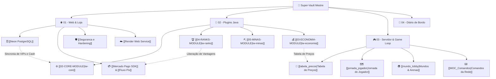

# 🧠 TW Network — Super-Vault Mestre (MOC)

> [!ABSTRACT] **Segundo Cérebro Unificado do Ecossistema TW Network**
> Este cofre centraliza toda a inteligência técnica, engenharia reversa, game design, esquemas de banco de dados, infraestrutura em nuvem e regras de plugins da rede **TW Network** (Servidor de Minecraft RankUP & Plataforma Web E-Commerce).

---

## 🗺️ Visão Integrada do Grafo (Graph Hub)

---

## 🧭 Clusters de Conhecimento

### 🌐 1. [[00 - MOC (Map of Content)|Plataforma Web & E-Commerce]]
*Documentação do frontend React 19, backend Express 5 e banco de dados na nuvem.*
* **Arquitetura & Segurança:** [[Tech Stack]] • [[Seguranca e Hardening]] • [[Autenticacao e Contas]]
* **Banco de Dados Relacional (Neon):** [[Neon PostgreSQL]] • [[Tabela Usuarios]] • [[Tabela Pedidos]] • [[Tabela Cupons]]
* **Pagamentos Automatizados:** [[Mercado Pago SDK]] • [[Fluxo Pix]]
* **Nuvem & Infraestrutura:** [[Render Web Service]] • [[Render Blueprint render.yaml]] • [[Variaveis de Ambiente]] • [[Configs de Servidor Nginx e Docker]]
* **Identidade Visual Minecraft:** [[Texturas e Icones Minecraft]] • [[Design System e Componentes]]

---

### 🧩 2. [[00-ROUTER-AND-TAXONOMY|Engenharia de Plugins Java (Purpur 26.3 & Java 25)]]
*Documentação técnica dos 9 módulos proprietários da suíte `tw-*` construídos em Maven.*
* **Diretrizes de Engenharia:** [[01-ARCHITECTURE-AND-CORE-RULES|Regras de Arquitetura, Concorrência e PDC]]
* **Módulos do Sistema:**
  * [[02-CORE-MODULE|tw-core]] — Fundação, HikariCP, TWUser, menus e TextDisplay
  * [[03-ECONOMIA-MODULE|tw-economia]] — Saldos (Money/Tokens/Souls), boosters e cheques
  * [[04-RANKS-MODULE|tw-ranks]] — Progressão A-Z, prestígios e correio
  * [[05-MINAS-MODULE|tw-minas]] — Central de minas, oficina, cartinhas e meteorito
  * [[06-TERRENOS-MODULE|tw-terrenos]] — Agência de lotes, voo protegido e compras atômicas
  * [[07-MAQUINAS-MODULE|tw-maquinas]] — Geradores em bloco, combustível e saque transacional
  * [[08-SPAWNERS-MODULE|tw-spawners]] — Geradores até 10k, modo virtual vs físico e almas
  * [[09-FARMS-MODULE|tw-farms]] — Plantações no plot, silos virtuais e enxadas em área
  * [[10-CAIXAS-MODULE|tw-caixas]] — Chaves virtuais, pity, roleta e consumíveis
* **Cookbook de Desenvolvimento:** [[11-FEATURE-COOKBOOK|Feature Cookbook]]

---

### 🎮 3. [[MOC_Geral|Servidor, Economia & Game Loop]]
*Configurações in-game, balanceamento econômico, menus e comandos do servidor.*
* **Centrais MOC:** [[MOC_Sistemas]] • [[MOC_Economia]] • [[MOC_Mundos]] • [[MOC_Comandos]] • [[MOC_Interacoes]]
* **Interfaces & UI/UX:** [[gui_design_system|Design System de Menus]] • [[gui_arquitetura_navegacao|Arquitetura de Navegação]] • [[gui_menu_principal|Hub Menu Principal]] • [[gui_minas|Central de Minas]] • [[gui_tw_plugins|Menus dos Plugins TW]]
* **Economia & Mercado:** [[tabela_precos|Tabela de Preços]] • [[fluxo_monetario|Fluxo Monetário]] • [[boosters_multiplicadores|Boosters]]
* **Game Loop & Gameplay:** [[jornada_jogador|Jornada do Jogador]] • [[combate_pvp|Combate PvP]]
* **Mundos:** [[mundo_lobby|Lobby Spawn]] • [[mundo_minas|Mundo Minas]] • [[mundo_terrenos|Terrenos PlotSquared]] • [[mundo_mina_pvp|Arena PvP]]
* **Comandos:** [[comandos_jogadores|Jogadores]] • [[comandos_economia|Economia]] • [[comandos_staff|Staff]] • [[comandos_admin|Admin]]

---

### 📅 4. Diário de Bordo & Decisões Históricas
*Registro cronológico de evolução do ecossistema:*
* [[2026-11-03 - Redesign Frontend e Seguranca]]
* [[2026-11-05 - Setup Neon e Deploy no Render]]
* [[2026-11-05 - Criacao do Super Vault Unificado]]
* [[2026-11-05 - Sincronizacao Frontend com Game Loop e Ranks]]
* [[2026-11-05 - Remocao de Contas Demo e Hardening de Producao]]
* [[2026-11-05 - Protocolo Estrito de Memoria e Vault-First]]
* [[2026-11-05 - Padronizacao e Redesign de Menus UI-UX]]

---

> [!TIP] Dica de Navegação no Obsidian
> Pressione **`Ctrl + G`** para abrir o **Graph View**. Os nós estão agrupados por cor: Ciano para Web, Verde para Plugins Java e Dourado para Game Loop/Economia!
