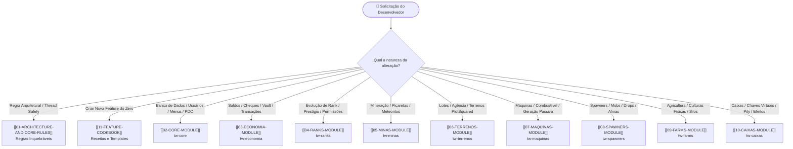

> [!INFO] **Navegação Rápida do Vault**
> 🏠 **Hub Central (MOC)** • ➡️ **Próximo:** [[01-ARCHITECTURE-AND-CORE-RULES|01. Regras de Arquitetura & Segurança]] • 📖 **Cookbook:** [[11-FEATURE-COOKBOOK|11. Feature Cookbook]]

# 🧭 Hub Central & Roteador de Contexto (MOC)

> [!SUMMARY] **Visão Executiva do Ecossistema**
> O **TW Network** é uma infraestrutura de alto desempenho para servidores Minecraft no modo **Tycoon / Rankup**, construída nativamente para **Java 25** e **Purpur 26.3**. 
> O ecossistema adota **PostgreSQL (HikariCP)** como backend relacional, **PersistentDataContainer (PDC)** para integridade de itens, e interface moderna via **Adventure MiniMessage** e **Display Entities (Text Display)**.

---

## 🗺️ Mapa de Navegação dos Módulos (Graph Hub)

Explore os 9 módulos internos interdependentes através do mapa abaixo:

| Módulo | Documento no Vault | Papel na Rede | Stack & Integrações | Status |
|---|---|---|---|:---:|
| `tw-core` | [[02-CORE-MODULE\|02. TW-Core]] | Fundação, Conexão DB, TWUser, Menus, PDC, Eventos | `HikariCP` • `PostgreSQL` • `TextDisplay` | 🟩 Ativo |
| `tw-economia` | [[03-ECONOMIA-MODULE\|03. TW-Economia]] | Saldos (Money/Tokens/Souls), Boosters, Cheques | `Vault API` • `PDC Signatures` | 🟩 Ativo |
| `tw-ranks` | [[04-RANKS-MODULE\|04. TW-Ranks]] | Progressão A-Z, Rank MAX, Prestígios, Correio | `LuckPerms` • `PlaceholderAPI` | 🟩 Ativo |
| `tw-minas` | [[05-MINAS-MODULE\|05. TW-Minas]] | Central de Minas, Oficina, Cartinhas, Meteorito | `RealMines Bridge` • `Hologramas Nativos` | 🟩 Ativo |
| `tw-terrenos` | [[06-TERRENOS-MODULE\|06. TW-Terrenos]] | Agência de Lotes, Voo Protegido, Compras Atômicas | `PlotSquared 7.6.0` • `WorldEdit/FAWE` | 🟩 Ativo |
| `tw-maquinas` | [[07-MAQUINAS-MODULE\|07. TW-Máquinas]] | Geradores em Bloco, Combustível, Saque Transacional | `Async Cycle` • `Display Entities` | 🟩 Ativo |
| `tw-spawners` | [[08-SPAWNERS-MODULE\|08. TW-Spawners]] | Geradores até 10k, Modo Virtual vs Físico, Almas | `PDC Entity Stacking` • `Auto-Sell` | 🟩 Ativo |
| `tw-farms` | [[09-FARMS-MODULE\|09. TW-Farms]] | Plantações no Plot, Silos Virtuais, Enxadas em Área | `Virtual Silos` • `Harvest Events` | 🟩 Ativo |
| `tw-caixas` | [[10-CAIXAS-MODULE\|10. TW-Caixas]] | Chaves Virtuais, Pity, Roleta, Consumíveis na Conta | `Roulette GUI` • `Effect Memory` | 🟩 Ativo |

---

## 🤖 Roteamento de Decisão para IAs (RAG Decision Tree)

Para consultas automatizadas ou implementação de novas tarefas, consulte a árvore de navegação abaixo:

---

## 📚 Glossário Rápido de Conceitos

> [!NOTE] **PDC (Persistent Data Container)**
> Mecanismo oficial da API Bukkit/Purpur para anexar dados tipados (`NamespacedKey`) em `ItemStack`, entidades e blocos. No projeto é abstraído por `br.com.tw.core.utils.TWItemTags`. **A lore de itens nunca deve ser usada como fonte de verdade**.

> [!IMPORTANT] **Main Thread Safety**
> Queries SQL e operações I/O rodam estritamente via `TWAsyncTaskQueue` ou `runTaskAsynchronously`. Retornos para modificar o jogo (inventários, mundos, jogadores) utilizam `runTask` na Main Thread.

> [!TIP] **Display Entities (Text Display)**
> Toda exibição flutuante de texto é feita via `TWHologram` nativo usando `Display.TextDisplay`, eliminando necessidade de plugins externos de hologramas.

---

> [!INFO] **Navegação de Rodapé**
> 🏠 **Hub Central (MOC)** • ➡️ **Próximo:** [[01-ARCHITECTURE-AND-CORE-RULES|01. Regras de Arquitetura & Segurança]] • 📖 **Cookbook:** [[11-FEATURE-COOKBOOK|11. Feature Cookbook]]
