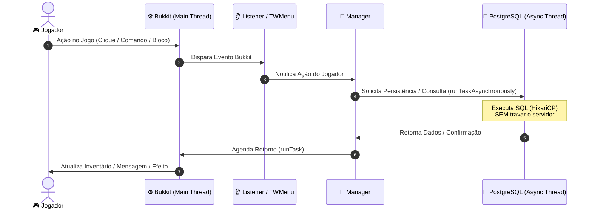

> [!INFO] **Navegação Rápida do Vault**
> ⬅️ **Anterior:** [[00-ROUTER-AND-TAXONOMY|00. Hub Central & MOC]] • 🏠 **MOC:** [[00-ROUTER-AND-TAXONOMY|Dashboard]] • ➡️ **Próximo:** [[02-CORE-MODULE|02. Módulo TW-Core]]

# 🛡️ Regras Inquebráveis de Arquitetura & Desenvolvimento

> [!ABSTRACT] **Premissas Absolutas**
> Este documento consolida os padrões mandatórios de código para o monorepo **TW-Plugin**. Nenhuma sugestão, refatoração ou nova funcionalidade pode violar as 8 regras descritas abaixo.

---

## 🚨 As 8 Regras Invioláveis

### 1. Main Thread Safety (I/O Assíncrono Estrito)
> [!DANGER] **NUNCA BLOQUEIE A MAIN THREAD COM I/O**
> - **Proibido:** Executar chamadas JDBC (`getConnection()`, `prepareStatement()`, queries SQL), leitura de disco síncrona ou requisições web na Main Thread do Bukkit.
> - **Obrigatório:** Utilize `TWAsyncTaskQueue` ou `Bukkit.getScheduler().runTaskAsynchronously(...)` para qualquer persistência.
> - **Transição de Retorno:** Ao concluir o trabalho assíncrono, **obrigatoriamente retorne para a Main Thread** (`Bukkit.getScheduler().runTask(...)`) antes de interagir com o jogador, inventários, entidades ou modificar blocos no mundo.

### 2. Prevenção Absoluta de Memory Leaks
> [!WARNING] **NUNCA ARMAZENE INSTÂNCIAS DE PLAYER**
> - **Proibido:** Salvar instâncias de `org.bukkit.entity.Player` em campos estáticos, HashMaps, Lists ou caches de longa duração.
> - **Obrigatório:** Armazene estritamente o identificador único `java.util.UUID` (`player.getUniqueId()`).
> - **Shutdown Limpo:** No método `onDisable()`, cancele todos os schedulers ativos, remova hologramas e descarregue caches da memória.

### 3. Adventure API & MiniMessage (Proibido ChatColor Legado)
> [!TIP] **COMUNICAÇÃO VISUAL MODERNA**
> - **Proibido:** O uso do caractere de seção `§` ou da classe legada `org.bukkit.ChatColor`.
> - **Obrigatório:** Utilize `net.kyori.adventure.text.Component` e `MiniMessage.miniMessage().deserialize("<color>...")`.
> - **Envio Nativo:** Envie mensagens e action bars com os métodos nativos do Paper: `player.sendMessage(Component)` e `player.sendActionBar(Component)`.

### 4. Metadados via PersistentDataContainer (PDC)
> [!IMPORTANT] **A LORE NÃO É FONTE DE DADOS**
> - **Proibido:** Fazer parsing de strings da lore ou do display name de itens para extrair níveis, quantias, IDs ou bônus. A lore é estritamente cosmética.
> - **Obrigatório:** Utilize o utilitário nativo `br.com.tw.core.utils.TWItemTags` (PDC sob a namespace `"tw"`). Todas as propriedades de itens (cheques, máquinas, chaves, ferramentas especiais) devem ser gravadas no container binário persistente.

### 5. PostgreSQL como Backend Oficial (Idempotência Estrita)
> [!IMPORTANT] **PERSISTÊNCIA RELACIONAL HIKARICP**
> - O backend é **PostgreSQL** via HikariCP no `tw-core`. Não assuma SQLite ou MySQL.
> - Toda criação de tabela deve utilizar `CREATE TABLE IF NOT EXISTS`.
> - Use operações de upsert seguras com `ON CONFLICT (...) DO UPDATE`.
> - Registre versões de schema via `DatabaseManager.recordSchemaVersion(modulo, versao)`.

### 6. Sistema de Menus Nativo (`TWMenu`)
> [!NOTE] **INVENTÁRIOS INTERATIVOS SEGUROS**
> - Todo inventário interativo DEVE implementar a interface `br.com.tw.core.menus.TWMenu` (`InventoryHolder`).
> - **Não crie listeners manuais de `InventoryClickEvent`**. O `MenuListener` centralizado no Core cancela o evento automaticamente e encaminha o clique para `menu.onClick(event)`.

### 7. Hologramas Nativos via Display Entities (Text Display)
> [!TIP] **ZERO DEPENDÊNCIAS EXTERNAS DE HOLOGRAMAS**
> - Não adicione plugins como DecentHolograms ou HolographicDisplays.
> - Utilize a classe `br.com.tw.core.utils.TWHologram`, baseada na entidade nativa `Display.TextDisplay` do Minecraft.

### 8. Compatibilidade Estrita Purpur 26.3 & Java 25
> [!NOTE] **PADRÕES MODERNOS DE JAVA**
> - O projeto é compilado com `<maven.compiler.release>25</maven.compiler.release>`.
> - Utilize recursos modernos do Java 25: records, pattern matching, switch expressions, text blocks e `var`.
> - **Proibido:** Dependências NMS versionadas (`net.minecraft.server.v1_...`). Utilize as APIs nativas do Purpur/Paper.

---

## 🔄 Fluxo Típico de Execução e Threading

---

> [!INFO] **Navegação de Rodapé**
> ⬅️ **Anterior:** [[00-ROUTER-AND-TAXONOMY|00. Hub Central & MOC]] • 🏠 **MOC:** [[00-ROUTER-AND-TAXONOMY|Dashboard]] • ➡️ **Próximo:** [[02-CORE-MODULE|02. Módulo TW-Core]]
