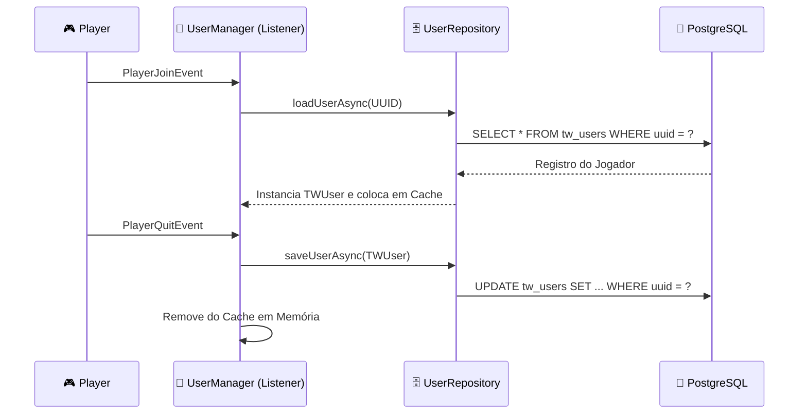

> [!INFO] **Navegação Rápida do Vault**
> ⬅️ **Anterior:** [[01-ARCHITECTURE-AND-CORE-RULES|01. Regras de Arquitetura]] • 🏠 **MOC:** [[00-ROUTER-AND-TAXONOMY|Dashboard]] • ➡️ **Próximo:** [[03-ECONOMIA-MODULE|03. Módulo TW-Economia]]

# 📦 Módulo TW-Core (Fundação e APIs Compartilhadas)

> [!SUMMARY] **Visão Geral**
> O `tw-core` é a espinha dorsal de toda a rede TW. Ele inicializa o pool de conexões com o PostgreSQL via HikariCP, orquestra o ciclo de vida dos dados dos jogadores (`TWUser`), oferece o sistema nativo de menus (`TWMenu`), o utilitário de NBT/PDC (`TWItemTags`), os hologramas via Display Entities (`TWHologram`), e publica os eventos de integração do servidor.

---

## 🛠️ Principais Componentes e Pacotes

```text
br.com.tw.core/
├── data/       -> TWUser, TWUserSnapshot, UserManager, UserRepository
├── database/   -> DatabaseManager (HikariCP, PostgreSQL, SchemaVersion)
├── events/     -> TWBlockMinedEvent, TWFarmHarvestEvent, TWMachineCycleEvent, TWSpawnerKillEvent
├── managers/   -> TWScoreboardManager, TWScoreboardStatsProvider
├── menus/      -> TWMenu, MenuListener, TWConfirmationMenu
└── utils/      -> TWItemTags, TWHologram, TWFormat, TWAsyncTaskQueue, TWLuckPermsGroups
```

---

## 🐘 1. Banco de Dados e Conexão (`DatabaseManager`)

Localizado em `br.com.tw.core.database.DatabaseManager`.
- Gerencia o `HikariDataSource` para PostgreSQL.
- Prioriza variáveis de ambiente sobre o `config.yml`:

| Variável de Ambiente | Caminho no `config.yml` | Valor Padrão |
|---|---|---|
| `TW_DB_HOST` | `postgresql.host` | `localhost` |
| `TW_DB_PORT` | `postgresql.port` | `5432` |
| `TW_DB_DATABASE` | `postgresql.database` | `tw_network_db` |
| `TW_DB_USERNAME` | `postgresql.username` | `""` *(obrigatório)* |
| `TW_DB_PASSWORD` | `postgresql.password` | `""` *(obrigatório)* |

> [!IMPORTANT] **Versionamento Automático de Schema**
> O método `recordSchemaVersion(String module, int version)` registra e versiona as migrações na tabela `tw_schema_version`:
> ```sql
> INSERT INTO tw_schema_version (module, version) VALUES (?, ?)
> ON CONFLICT (module) DO UPDATE SET version = GREATEST(tw_schema_version.version, EXCLUDED.version), updated_at = CURRENT_TIMESTAMP;
> ```

---

## 👤 2. Dados do Usuário (`TWUser` & `UserManager`)

Localizado em `br.com.tw.core.data.*`.
Representa a conta do jogador na tabela `tw_users`:
- `money` (`NUMERIC(20,2)` / `BigDecimal`)
- `tokens` (`BIGINT` / `long`)
- `souls` (`BIGINT` / `long`)
- `rank_id` (`VARCHAR(32)`)
- `prestige_id` (`VARCHAR(32)`)

### Ciclo de Carregamento e Salvamento:


> [!NOTE] **Shutdown Seguro**
> No método `onDisable()`, o Core invoca `userManager.saveAllSync()`, gravando todos os dados em memória para evitar perdas caso o servidor seja desligado abruptamente.

---

## 🪟 3. Menus Interativos Nativos (`TWMenu`)

A interface `TWMenu` estende `InventoryHolder`:
```java
public interface TWMenu extends InventoryHolder {
    void onClick(InventoryClickEvent event);
}
```

> [!TIP] **Manipulação de Cliques Automática**
> O ouvinte `br.com.tw.core.menus.MenuListener` intercepta qualquer `InventoryClickEvent`. Se o inventário for uma instância de `TWMenu`, ele **cancela o clique automaticamente** (`event.setCancelled(true)`) e chama o método `menu.onClick(event)`, prevenindo furto de itens ou exploits de clique rápido.

---

## 🏷️ 4. Metadados de Itens (`TWItemTags`)

Gerencia metadados no `PersistentDataContainer` (PDC) sob o namespace `"tw"`:

```java
// Exemplo: Gravando dados estruturados
Map<String, Object> tags = Map.of(
    "machine_type", "MINERADORA",
    "machine_level", 5,
    "stored_fuel", 1250L
);
TWItemTags.set(itemStack, tags);

// Exemplo: Lendo dados com segurança
long fuel = TWItemTags.getLong(itemStack, "stored_fuel", 0L);
String type = TWItemTags.getString(itemStack, "machine_type");
```

---

## 🔮 5. Hologramas Nativos (`TWHologram`)

- Usa `org.bukkit.entity.TextDisplay` da API Bukkit moderna.
- Suporta interpolação de transformação, cores de fundo com transparência e alinhamento billboard.
- Criação e remoção nativa sem necessidade de plugins de terceiros.

---

> [!INFO] **Navegação de Rodapé**
> ⬅️ **Anterior:** [[01-ARCHITECTURE-AND-CORE-RULES|01. Regras de Arquitetura]] • 🏠 **MOC:** [[00-ROUTER-AND-TAXONOMY|Dashboard]] • ➡️ **Próximo:** [[03-ECONOMIA-MODULE|03. Módulo TW-Economia]]
