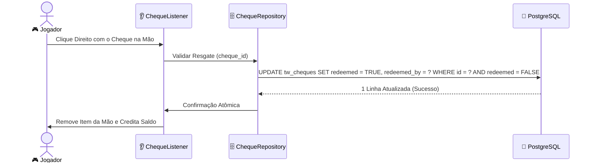

> [!INFO] **Navegação Rápida do Vault**
> ⬅️ **Anterior:** [[02-CORE-MODULE|02. Módulo TW-Core]] • 🏠 **MOC:** [[00-ROUTER-AND-TAXONOMY|Dashboard]] • ➡️ **Próximo:** [[04-RANKS-MODULE|04. Módulo TW-Ranks]]

# 💰 Módulo TW-Economia (Sistema Financeiro da Rede)

> [!SUMMARY] **Visão Geral**
> O `tw-economia` coordena os saldos monetários, transações entre jogadores (`/pay`), ranking dos mais ricos (`/baltop`), emissão e resgate seguro de notas físicas de cheque com assinatura digital via PDC, além de registrar o provedor oficial de economia na **Vault API**.

---

## 🪙 As Três Moedas do Servidor

| Moeda | Identificador Interno | Tipo de Dado | Propósito Principal |
|---|---|---|---|
| **Money** | `money` | `NUMERIC(20,2)` (`BigDecimal`) | Moeda primária da rede para compras de lotes, máquinas, rankup e lojas. |
| **Tokens** | `tokens` | `BIGINT` (`long`) | Moeda de mineração e eventos, usada para upgrades de ferramentas e oficinas. |
| **Almas** | `souls` | `BIGINT` (`long`) | Moeda especial obtida em spawners, usada na forja de chaves e encantamentos raros. |

---

## 📜 Comandos Disponíveis

| Comando | Aliases | Permissão | Descrição |
|---|---|---|---|
| `/money` | `/bal`, `/balance`, `/saldo` | Nenhuma (pública) | Consulta saldo próprio ou de outro jogador. |
| `/pay` | `/pagar` | Nenhuma (pública) | Transfere saldo para outro jogador de forma segura e atômica. |
| `/baltop` | `/magnatas`, `/topmoney` | Nenhuma (pública) | Exibe o ranking dos maiores magnatas da economia. |
| `/cheque` | — | Nenhuma (pública) | Converte parte do saldo virtual em um cheque físico. |
| `/eco` | — | `tw.admin` | Dá, retira ou define o saldo de qualquer moeda para jogadores. |
| `/booster` | — | `tw.admin` | Ativa um multiplicador global temporário de ganhos na rede. |

---

## 🧾 Sistema de Cheques com Assinatura Digital PDC

Para permitir o comércio livre de dinheiro sem riscos de dupes:
1. O comando `/cheque <valor>` valida se o jogador possui o saldo.
2. Debita o valor da conta e gera um `ItemStack` especial (Papel assinado).
3. Grava as seguintes tags no PDC via `TWItemTags`:
   - `cheque_id`: UUID único do documento (`UUID.randomUUID().toString()`).
   - `cheque_amount`: Quantia gravada no cheque.
   - `cheque_issuer`: UUID do jogador emissor.
4. Insere o registro na tabela `tw_cheques` com `redeemed = FALSE`.

> [!TIP] **Proteção contra Duplicações**
> O resgate do cheque é **estritamente atômico no PostgreSQL**. Mesmo se um jogador tentar clicar duas vezes rapidamente ou tentar clonar o item visual, a consulta SQL com condição `redeemed = FALSE` impede que mais de uma tentativa obtenha sucesso.

---

## 🔌 Integrações: Vault & PlaceholderAPI

- **Vault API**: Implementa `net.milkbowl.vault.economy.Economy`, permitindo compatibilidade imediata com qualquer plugin externo que necessite de transações.
- **PlaceholderAPI (`TWEcoExpansion`)**:
  - `%tw_money%` -> Saldo bruto (ex: `1500000.50`)
  - `%tw_money_formatted%` -> Saldo formatado em sufixos (ex: `1.5M`)
  - `%tw_tokens%` -> Quantidade de tokens
  - `%tw_souls%` -> Quantidade de almas
  - `%tw_booster%` -> Multiplicador global atual ativo

---

> [!INFO] **Navegação de Rodapé**
> ⬅️ **Anterior:** [[02-CORE-MODULE|02. Módulo TW-Core]] • 🏠 **MOC:** [[00-ROUTER-AND-TAXONOMY|Dashboard]] • ➡️ **Próximo:** [[04-RANKS-MODULE|04. Módulo TW-Ranks]]
