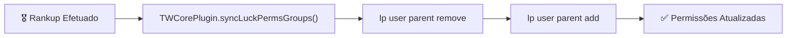

> [!INFO] **Navegação Rápida do Vault**
> ⬅️ **Anterior:** [[03-ECONOMIA-MODULE|03. Módulo TW-Economia]] • 🏠 **MOC:** [[00-ROUTER-AND-TAXONOMY|Dashboard]] • ➡️ **Próximo:** [[05-MINAS-MODULE|05. Módulo TW-Minas]]

# 🎖️ Módulo TW-Ranks (Esteira de Progressão Tycoon)

> [!SUMMARY] **Visão Geral**
> O `tw-ranks` controla o avanço de níveis dos jogadores. Ao acumular dinheiro suficiente, o jogador pode comprar o próximo rank através do `/rankup` ou comprar múltiplos níveis de uma vez com `/rankupmax`. Ao alcançar o rank `MAX`, é desbloqueada a mecânica de **Prestígio**, que reinicia os ranks em troca de multiplicadores e permissões permanentes.

---

## 🧭 Comandos Registrados

| Comando | Aliases | Permissão | Descrição |
|---|---|---|---|
| `/rankup` | — | Nenhuma (pública) | Compra o próximo rank da esteira de progressão. |
| `/rankupmax` | — | Nenhuma (pública) | Calcula e compra o número máximo de ranks possíveis com o saldo atual. |
| `/prestigio` | — | Nenhuma (pública) | Realiza o prestígio ao atingir o rank `MAX`. |
| `/ranks` | `/rank` | Nenhuma (pública) | Abre o menu GUI interativo (`RanksMenu`) exibindo a trilha completa. |
| `/twadmin` | — | `tw.admin` | Altera manualmente o rank ou prestígio de um jogador. |

---

## 🪜 Configuração e Sincronização com LuckPerms

### Hierarquia de Ranks
A ordem dos ranks é definida na lista mestra em `tw-core/config.yml` (ex: `Membro`, `Bronze`, `Prata`, `Ouro`, ..., `MAX`).
Cada rank possui suas propriedades em `tw-ranks/ranks.yml`:
- `cost`: Preço necessário para evoluir.
- `prefix`: Prefixo cosmético para chat e tablist.
- `rewards`: Itens e comandos concedidos na evolução.

### Sincronização Automática com LuckPerms
Sempre que um jogador avança de rank ou realiza prestígio:

> [!NOTE] **Permissões Granulares por Rank**
> Esse mecanismo garante que novos mundos, minas, limites de terrenos e comandos sejam liberados no LuckPerms de forma automática e auditável pelo console.

---

## 🪟 Menu Visual de Ranks (`RanksMenu`)

O menu implementa `TWMenu` e divide a visualização em 3 estados:
- 🟩 **Concluído**: Ranks já superados pelo jogador.
- 🟨 **Atual / Disponível**: O rank que o jogador está trilhando, exibindo porcentagem de saldo acumulada e custo restante.
- 🟥 **Bloqueado**: Ranks futuros na escada de progressão.

---

## 📬 Entrega Segura via Correio Virtual (`Mailbox`)

> [!TIP] **Proteção contra Inventário Cheio**
> Se um rank conceder itens especiais como recompensa e o inventário do jogador não possuir espaço livre:
> - O utilitário `MailboxRewardDelivery` redireciona os itens excedentes diretamente para a tabela `tw_crate_mail` (gerenciada pelo `tw-caixas`).
> - O jogador é notificado para resgatar seus itens posteriormente através do comando `/key correio`, evitando perda de drops no chão.

---

> [!INFO] **Navegação de Rodapé**
> ⬅️ **Anterior:** [[03-ECONOMIA-MODULE|03. Módulo TW-Economia]] • 🏠 **MOC:** [[00-ROUTER-AND-TAXONOMY|Dashboard]] • ➡️ **Próximo:** [[05-MINAS-MODULE|05. Módulo TW-Minas]]
