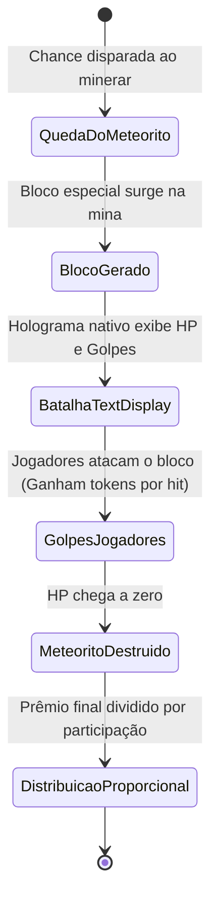

> [!INFO] **Navegação Rápida do Vault**
> ⬅️ **Anterior:** [[04-RANKS-MODULE|04. Módulo TW-Ranks]] • 🏠 **MOC:** [[00-ROUTER-AND-TAXONOMY|Dashboard]] • ➡️ **Próximo:** [[06-TERRENOS-MODULE|06. Módulo TW-Terrenos]]

# ⛏️ Módulo TW-Minas (Gameplay Ativo de Mineração)

> [!SUMMARY] **Visão Geral**
> O `tw-minas` gerencia a experiência de mineração ativa: minas divididas por rank com reset automático (via integração `RealMines`), central de minas com teleporte, oficina de evolução de picaretas, missões/cartinhas colecionáveis com buffs passivos e o evento cooperativo do **Meteorito** com holograma nativo TextDisplay.

---

## 🪟 Menus da Central de Mineração (`/mina`)

O comando `/mina` (ou `/minas`) abre o menu principal `MinaMainMenu`:

| Submenu | Classe do Menu | Descrição |
|---|---|---|
| **Teleporte da Mina** | `MinaMainMenu` | Teleporta imediatamente para a mina do rank atual do jogador. |
| **Catálogo de Minas** | `CatalogoMenu` | Lista todas as minas do servidor, blocos disponíveis e tempo para o reset. |
| **Oficina de Picaretas** | `OficinaMenu` | Interface para evoluir atributos da ferramenta (Fortuna, Eficiência, Explosão, Venda). |
| **Álbum de Cartinhas** | `CartinhasMenu` | Exibe cartas colecionáveis desbloqueadas que concedem bônus permanentes. |
| **Ranking de Mineração** | `RankingMenu` | Tabela com os maiores mineradores de blocos da temporada. |

---

## ⛏️ Ciclo de Mineração e Multiplicadores

Ao quebrar um bloco dentro de uma mina registrada:
1. O `MineracaoListener` cancela os drops normais no chão (sem lixo no mapa).
2. Dispara o evento customizado `TWBlockMinedEvent`.
3. Calcula o rendimento em **Dinheiro** e **Tokens** considerando a cadeia de multiplicadores:
   ```text
   Rendimento Final = ValorBase 
                    * MultiplicadorBoosterGlobal 
                    * MultiplicadorPicareta 
                    * BonusComboContinuo 
                    * BonusCartinhasAtivas 
                    * MultiplicadorConsumivelCaixas (Contrato / Broca)
   ```
4. Credita os valores diretamente no `TWUser` do jogador e exibe atualização dinâmica na Action Bar (`ActionBarUtil`).

---

## ☄️ Evento Global do Meteorito

A cada bloco quebrado, há uma chance configurável (`events.meteorite-chance`, padrão 0,005%) de invocar um **Meteorito**:



> [!TIP] **Holograma Nativo e Entrega Segura**
> - O meteorito utiliza a entidade nativa `TextDisplay` (`TWHologram`), exibindo barra de vida colorida e o ranking dos jogadores com mais golpes.
> - Se algum jogador participante estiver offline no momento da destruição final, a sua cota é salva em `plugins/tw-minas/meteorite-rewards.yml` e entregue no próximo login.

---

> [!INFO] **Navegação de Rodapé**
> ⬅️ **Anterior:** [[04-RANKS-MODULE|04. Módulo TW-Ranks]] • 🏠 **MOC:** [[00-ROUTER-AND-TAXONOMY|Dashboard]] • ➡️ **Próximo:** [[06-TERRENOS-MODULE|06. Módulo TW-Terrenos]]
