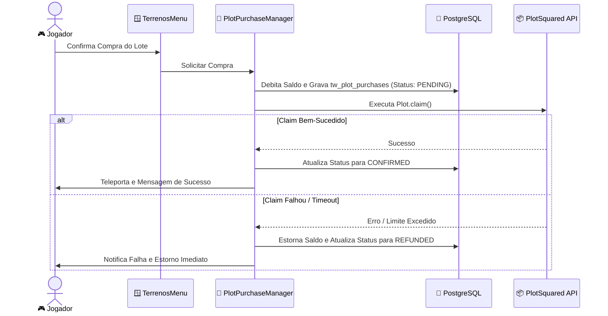

> [!INFO] **Navegação Rápida do Vault**
> ⬅️ **Anterior:** [[05-MINAS-MODULE|05. Módulo TW-Minas]] • 🏠 **MOC:** [[00-ROUTER-AND-TAXONOMY|Dashboard]] • ➡️ **Próximo:** [[07-MAQUINAS-MODULE|07. Módulo TW-Máquinas]]

# 🏡 Módulo TW-Terrenos (Agência Imobiliária de Plots)

> [!SUMMARY] **Visão Geral**
> O `tw-terrenos` atua como a agência imobiliária do servidor integrada ao **PlotSquared 7.6.0**. Ele gerencia a venda de terrenos com precificação exponencial, transações financeiras atômicas contra falhas, controle de limites por rank/prestígio, e aplicação de regras estritas de segurança no mundo de plots (voo condicional, ausência de fome/dano, proteção contra explosões).

---

## 🗺️ Comandos Registrados

| Comando | Aliases | Permissão | Descrição |
|---|---|---|---|
| `/terreno` | `/terrenos` | Nenhuma (pública) | Abre o menu da agência de terrenos (`TerrenosMenu`). |
| `/terrenosadmin` | — | `tw-terrenos.admin` | Ferramenta de auditoria e auditoria de compras/reembolsos para a equipe. |

> [!NOTE] **Comandos Nativos do PlotSquared**
> Os comandos `/plot` e `/p` são mantidos para as operações internas do lote gerenciadas pelo PlotSquared (como `/p trust`, `/p add`, `/p remove`, `/p merge`, `/p visit`).

---

## 📈 Precificação Exponencial e Compras Atômicas

### Tabela de Progressão de Preços
O custo do terreno dobra a cada aquisição subsequente do jogador:
- **1º Lote:** $50.000
- **2º Lote:** $100.000
- **3º Lote:** $200.000
- **4º Lote:** $400.000
- **Fórmula:** $\text{Preço} = \text{basePrice} \times 2^{\text{lotesPossuídos}}$

### Fluxo de Transação Segura com Status `PENDING`
Para evitar duplicação ou perda de saldo caso o servidor reinicie durante uma geração de lote:

> [!TIP] **Reconciliação no Boot**
> Se o servidor cair no momento exato entre o débito e o claim, a rotina de inicialização do `tw-terrenos` busca compras com status `PENDING` e executa a reconciliação automática, estornando o dinheiro do jogador de forma idempotente.

---

## 🛡️ Regras do Mundo de Plots (`PlotWorldRulesListener`)

No mundo `terrenos`, o listener aplica proteções contínuas:
1. **Controle de Voo (/fly)**: O voo é liberado automaticamente apenas enquanto o jogador estiver dentro de um lote próprio ou onde seja membro adicionado. Ao pisar na rua ou em lotes alheios sem permissão, o voo é desativado instantaneamente.
2. **Sem Fome**: `FoodLevelChangeEvent` é cancelado.
3. **Sem Danos**: Bloqueio de dano por queda, fogo, lava e monstros.
4. **Sem Monstros Nativos**: O surgimento natural de monstros vanilla é desativado; apenas spawners gerenciados pelo `tw-spawners` podem operar.

---

> [!INFO] **Navegação de Rodapé**
> ⬅️ **Anterior:** [[05-MINAS-MODULE|05. Módulo TW-Minas]] • 🏠 **MOC:** [[00-ROUTER-AND-TAXONOMY|Dashboard]] • ➡️ **Próximo:** [[07-MAQUINAS-MODULE|07. Módulo TW-Máquinas]]
