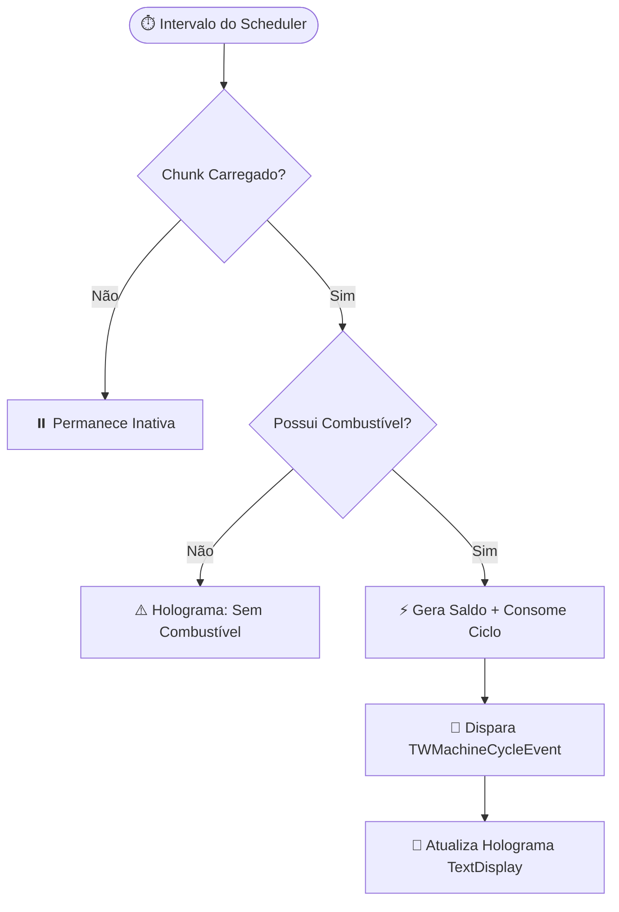

> [!INFO] **Navegação Rápida do Vault**
> ⬅️ **Anterior:** [[06-TERRENOS-MODULE|06. Módulo TW-Terrenos]] • 🏠 **MOC:** [[00-ROUTER-AND-TAXONOMY|Dashboard]] • ➡️ **Próximo:** [[08-SPAWNERS-MODULE|08. Módulo TW-Spawners]]

# ⚙️ Módulo TW-Máquinas (Geração Passiva de Saldo)

> [!SUMMARY] **Visão Geral**
> O `tw-maquinas` implementa a mecânica Tycoon de máquinas geradoras colocadas em blocos físicos dentro dos lotes de terrenos. Cada máquina opera com ciclos de combustível/bateria, acumula saldo passivamente enquanto o chunk estiver carregado e possui hologramas nativos em **Text Display** exibindo status, nível e lucros represados.

---

## 🧭 Comandos Registrados

| Comando | Aliases | Permissão | Descrição |
|---|---|---|---|
| `/maquinas` | `/maquina` | Nenhuma (pública) | Abre a loja de máquinas (`MachineShopMenu`) ou painel de gerenciamento. |
| `/maquinas status` | — | `tw-maquinas.admin` | Diagnóstico de máquinas registradas, ativas e saldo represado na rede. |
| `/maquinas jogador <nome>` | — | `tw-maquinas.admin` | Consulta máquinas pertencentes a um jogador específico. |

---

## ⚡ Ciclo Operacional das Máquinas

### 1. Estrutura em Bloco e Empilhamento (Stacks)
- Máquinas são colocadas sobre blocos físicos (ex: Bloco de Redstone, Bloco de Diamante).
- É possível empilhar múltiplas máquinas no mesmo bloco físico (ex: até 25 unidades por bloco ou limite do lote configurado em `max-machines-per-plot`).
- O identificador de localização segue o padrão `world;x;y;z`.

### 2. Motor de Processamento Assíncrono
A cada intervalo configurado:
1. O `MachineManager` itera sobre as máquinas com chunk carregado (`isChunkLoaded`).
2. Se a máquina possui combustível (`fuelCycles > 0`):
   - Consome 1 ciclo de combustível.
   - Calcula o rendimento: `(rendimentoBase * stackAmount) * multiplicadorUpgrades`.
   - Dispara o evento interno `TWMachineCycleEvent`.
   - Atualiza o holograma visual via `HologramManager`.
3. Máquinas em chunks descarregados não produzem offline, preservando CPU do servidor.

---

## 🔮 Hologramas Nativos (`HologramManager`)

- Construídos via `TextDisplay` nativo (`TWHologram`).
- Informações exibidas dinamicamente em tempo real:
  - Tipo e nome colorido da máquina.
  - Quantidade empilhada (ex: `x10`).
  - Nível de upgrades adquiridos.
  - Barra de combustível restante com código de cores.
  - Saldo acumulado aguardando coleta.

> [!TIP] **Limpeza de Hologramas Órfãos**
> A rotina `startOrphanCleanup` executa varreduras periódicas e remove automaticamente qualquer TextDisplay que tenha perdido sua máquina correspondente no banco.

---

## 💰 Coleta Atômica de Lucros

Ao acessar o menu `MachinePanelMenu` e solicitar a coleta de lucros:
1. A transação SQL no PostgreSQL zera o saldo da máquina (`stored_money = 0`) e credita o valor na tabela `tw_users` em uma **única transação atômica**.
2. Isso impede que falhas na conexão gerem duplicação de saldo ou perda de dinheiro.
3. A interface do jogador e o holograma são atualizados na Main Thread em seguida.

---

> [!INFO] **Navegação de Rodapé**
> ⬅️ **Anterior:** [[06-TERRENOS-MODULE|06. Módulo TW-Terrenos]] • 🏠 **MOC:** [[00-ROUTER-AND-TAXONOMY|Dashboard]] • ➡️ **Próximo:** [[08-SPAWNERS-MODULE|08. Módulo TW-Spawners]]
