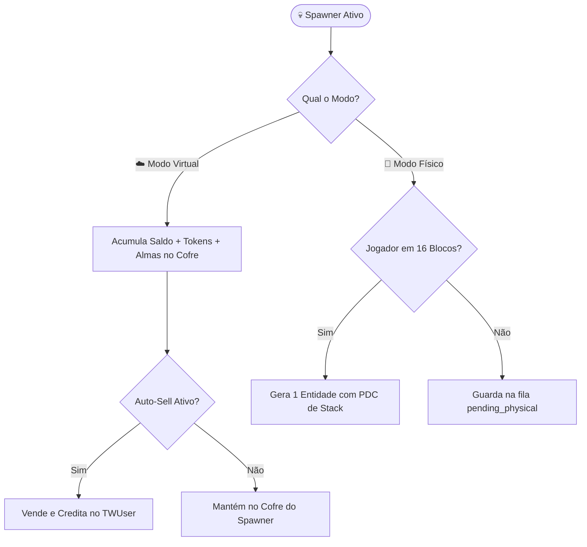

> [!INFO] **Navegação Rápida do Vault**
> ⬅️ **Anterior:** [[07-MAQUINAS-MODULE|07. Módulo TW-Máquinas]] • 🏠 **MOC:** [[00-ROUTER-AND-TAXONOMY|Dashboard]] • ➡️ **Próximo:** [[09-FARMS-MODULE|09. Módulo TW-Farms]]

# 💀 Módulo TW-Spawners (Geradores de Monstros e Almas)

> [!SUMMARY] **Visão Geral**
> O `tw-spawners` implementa uma solução de alta performance para geradores de monstros empilháveis (com suporte a até **10.000 unidades por stack**). Possui dois modos operacionais: **Modo Virtual** (produção passiva direta no cofre sem gerar entidades, ideal para lag zero) e **Modo Físico** (com entidades empilhadas no PDC e buffer de geração pendente).

---

## 🧭 Comandos Registrados

| Comando | Aliases | Permissão | Descrição |
|---|---|---|---|
| `/spawners` | `/spawner`, `/geradores` | Nenhuma (pública) | Abre a loja de geradores (`SpawnerShopMenu`) ou gerencia o spawner clicado. |
| `/spawners status` | — | `tw-spawners.admin` | Exibe totais de geradores na rede, chunks carregados e buffer pendente. |
| `/spawners jogador <nome>` | — | `tw-spawners.admin` | Informa dados de geradores pertencentes a um jogador. |

---

## ⚙️ Comparativo: Modo Virtual vs Modo Físico

| Característica | ☁️ Modo Virtual | 🧟 Modo Físico |
|---|---|---|
| **Impacto de TPS / Entidades** | **Zero lag**: Nenhuma entidade Bukkit gerada no mundo. | **Controlado**: 1 única entidade empilhada representa todo o grupo. |
| **Geração de Recursos** | Acumula Dinheiro, Tokens, XP e Almas no cofre interno. | Mobs devem ser abatidos pelo jogador ou mecanismos de farm. |
| **Presença de Jogador** | Opera enquanto o chunk estiver carregado. | Requer jogador no raio de 16 blocos para materializar. |
| **Recursos Represados** | Salvos diretamente no banco `tw_spawners`. | Entidades armazenam o tamanho do stack no **PDC**. |
| **Auto-Sell** | Suportado: Venda automática periódica de produção. | Não aplicável (drops físicos ou coleta direta). |

---

## 👻 A Moeda das Almas (`Souls`)

> [!NOTE] **Importância das Almas na Economia**
> Cada mob abatido em spawner gera **Almas (`souls`)**, persistidas como `BIGINT` no `TWUser`.
> As almas são o recurso primordial para:
> - Forja de chaves divinas no `tw-caixas` (`/key forja`).
> - Upgrades avançados de máquinas e silos de farm.
> - Ativação do consumível **Ímã de Almas** (dobra a coleta por abate).

---

## 💰 Coleta e Desmonte Seguro

- **Saque Seguro**: No painel do spawner (`SpawnerPanelMenu`), o proprietário pode recolher o saldo acumulado. A transação debita o cofre e credita o usuário de forma atômica no PostgreSQL.
- **Desmonte**: Só é permitido ao proprietário após esvaziar totalmente o cofre do spawner e possuir espaço livre no inventário. O bloco devolve o item com todas as propriedades de stack salvas no PDC.

---

> [!INFO] **Navegação de Rodapé**
> ⬅️ **Anterior:** [[07-MAQUINAS-MODULE|07. Módulo TW-Máquinas]] • 🏠 **MOC:** [[00-ROUTER-AND-TAXONOMY|Dashboard]] • ➡️ **Próximo:** [[09-FARMS-MODULE|09. Módulo TW-Farms]]
