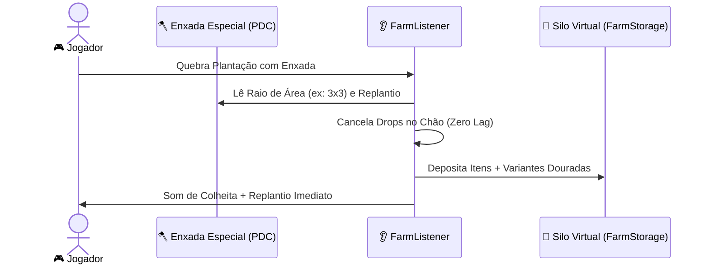

> [!INFO] **Navegação Rápida do Vault**
> ⬅️ **Anterior:** [[08-SPAWNERS-MODULE|08. Módulo TW-Spawners]] • 🏠 **MOC:** [[00-ROUTER-AND-TAXONOMY|Dashboard]] • ➡️ **Próximo:** [[10-CAIXAS-MODULE|10. Módulo TW-Caixas]]

# 🌾 Módulo TW-Farms (Agricultura e Silos Virtuais)

> [!SUMMARY] **Visão Geral**
> O `tw-farms` gerencia a agricultura em escala. Ele permite que os jogadores construam plantações físicas reais nos seus terrenos (`terrenos`), mas elimina todo o lag de itens jogados no chão: ao colher, os produtos são transferidos instantaneamente para **Silos Virtuais** (`FarmStorage`), onde podem ser vendidos manualmente, com **Auto-Sell**, ou sacados em itens físicos.

---

## 🧭 Comandos Registrados

| Comando | Aliases | Permissão | Descrição |
|---|---|---|---|
| `/farm` | `/farms` | Nenhuma (pública) | Abre o silo virtual principal do jogador (`FarmStorageMenu`). |
| `/farm silo` | `/farm armazem` | Nenhuma (pública) | Atalho direto para gerenciar colheitas armazenadas. |
| `/farm loja` | `/farm shop` | Nenhuma (pública) | Loja de ferramentas especiais, sementes e fertilizantes. |

---

## 🌱 Dinâmica de Plantações e Colheita em Área

### 1. Culturas Físicas Reconhecidas (`PhysicalCrop`)
- Culturas como trigo, batata, cenoura, cana-de-açúcar, melão, abóbora e fungo do nether são registradas pelo jogador no lote.
- As culturas se desenvolvem com o ciclo vanilla ou aceleradas por **fertilizantes e boosters temporários**.

### 2. Ferramentas Especiais de Colheita
Ferramentas vendidas na loja possuem tags específicas gravadas via `TWItemTags`:
- `farm_tool_radius`: Raio de quebra em área (ex: `3` para 3x3, `5` para 5x5).
- `farm_tool_replant`: Booleano indicando se replanta a semente automaticamente ao colher.
- `farm_tool_multiplier`: Multiplicador de itens gerados por colheita.

---

## 📦 Silo Virtual e Auto-Sell (`FarmStorageMenu`)

No menu do silo, o jogador pode interagir com o estoque acumulado:

> [!TIP] **Recursos do Silo Virtual**
> - **Venda em Massa:** Converte o estoque de uma cultura em saldo monetário na cotação do servidor.
> - **Auto-Sell:** Ativa a venda automática contínua de qualquer colheita que entre no silo.
> - **Variantes Raras (Culturas Douradas):** Culturas mutantes colhidas com ferramentas avançadas valem até 10x mais que o produto normal.
> - **Recolha Física:** Permite sacar itens do silo para o inventário com tags protegidas contra duplicação.

---

> [!INFO] **Navegação de Rodapé**
> ⬅️ **Anterior:** [[08-SPAWNERS-MODULE|08. Módulo TW-Spawners]] • 🏠 **MOC:** [[00-ROUTER-AND-TAXONOMY|Dashboard]] • ➡️ **Próximo:** [[10-CAIXAS-MODULE|10. Módulo TW-Caixas]]
