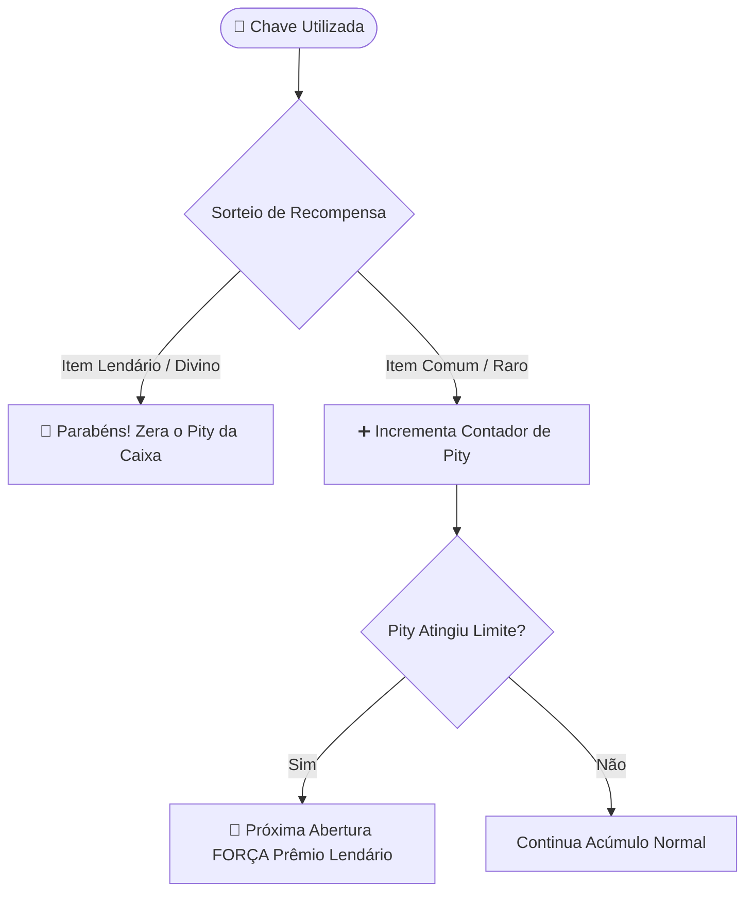

> [!INFO] **Navegação Rápida do Vault**
> ⬅️ **Anterior:** [[09-FARMS-MODULE|09. Módulo TW-Farms]] • 🏠 **MOC:** [[00-ROUTER-AND-TAXONOMY|Dashboard]] • ➡️ **Próximo:** [[11-FEATURE-COOKBOOK|11. Feature Cookbook]]

# 🎁 Módulo TW-Caixas (Chaves Virtuais e Recompensas)

> [!SUMMARY] **Visão Geral**
> O `tw-caixas` é a central de recompensas da rede. Todas as chaves e pity são **100% virtuais**, armazenadas no PostgreSQL sem ocupar espaço no inventário. O módulo oferece animações fluidas de roleta (`ManualOpeningMenu`), abertura em massa (`CrateBulkMenu`), correio virtual para itens excedentes e um subsistema inovador de **consumíveis com cargas persistentes na conta** (`PlayerEffectMemory`).

---

## 🧭 Comandos Registrados

### Comandos de Jogador (`/key` ou `/caixas`)
- `/key`: Abre o painel central de chaves (`KeyPanelMenu`).
- `/key abrir <tipo> [quantidade]`: Inicia a abertura (1 chave = roleta manual; >1 = abertura em massa).
- `/key enviar <jogador> <tipo> <quantidade>`: Transfere chaves de forma segura para outro usuário.
- `/key forja`: Forja chaves de maior raridade combinando chaves menores e almas (`KeyForgeMenu`).
- `/key correio`: Abre o armazém de recompensas pendentes (`tw_crate_mail`).
- `/key efeitos`: Consulta o saldo de cargas ativas de consumíveis vinculados à conta.

### Comandos de Administração (`/caixa` - Permissão `tw.admin`)
- `/caixa dar <jogador> <tipo> <quantidade>`: Adiciona chaves virtuais diretamente à carteira do jogador.
- `/caixa setar <tipo>`: Transforma o bloco olhado em uma caixa física com holograma.
- `/caixa remover`: Remove a caixa física selecionada.
- `/caixa daritem <jogador> <efeito> [cargas]`: Entrega o item físico de efeito consumível.
- `/caixa reload`: Recarrega o catálogo e tabelas de probabilidade.

---

## 🎰 Roleta e Sistema de Pity Progressivo

> [!TIP] **Selo da Fortuna Divina**
> O consumível `divine_seal`, se detectado no inventário do jogador durante uma abertura, é consumido e **garante 100% de chance** de prêmio lendário imediato, tanto na roleta manual quanto na abertura em massa.

---

## ⚡ Efeitos e Consumíveis na Conta (`tw_crate_player_effects`)

Diferente de consumíveis tradicionais de inventário, os efeitos de caixas são consumidos e registrados como **cargas associadas ao UUID do jogador** (`PlayerEffectMemory`). Isso permite que os buffs continuem ativos mesmo após o jogador trocar de mundo (Lobby -> Minas -> Plots):

| Efeito | Ação Prática no Jogo | Tabela / Onde Atua |
|---|---|---|
| **Contrato de Mineração** | Dobra o pagamento por bloco quebrado na mina. | `tw-minas` (MineracaoListener) |
| **Carga Sísmica** | Concede raio 3x3 de quebra na picareta por carga. | `tw-minas` (MineracaoListener) |
| **Broca de Alta Rotação** | Concede +20% de dinheiro por bloco na mina. | `tw-minas` (MineracaoListener) |
| **Ímã de Almas** | Coleta almas em dobro ao abater mobs em geradores. | `tw-spawners` (SpawnerListener) |
| **Baterias / Overclock** | Acelera ciclos de produção e abastece máquinas. | `tw-maquinas` (MachineListener) |

---

> [!INFO] **Navegação de Rodapé**
> ⬅️ **Anterior:** [[09-FARMS-MODULE|09. Módulo TW-Farms]] • 🏠 **MOC:** [[00-ROUTER-AND-TAXONOMY|Dashboard]] • ➡️ **Próximo:** [[11-FEATURE-COOKBOOK|11. Feature Cookbook]]
