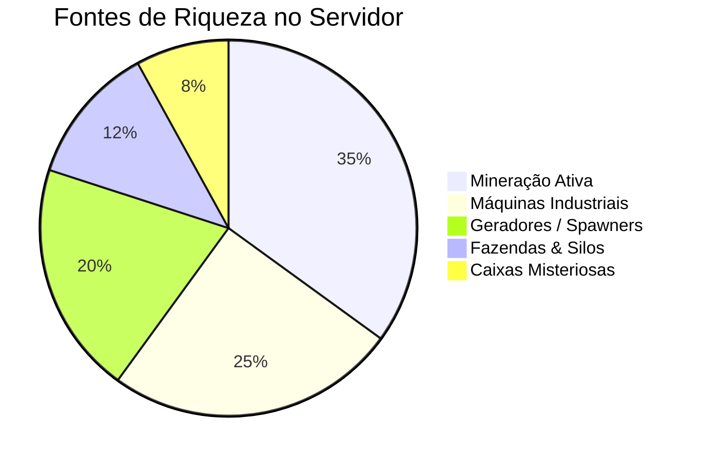

📍 [[MOC_Geral|Início]] ➔ **MOC Economia**

# 💰 Central de Economia e Finanças

> [!abstract] Resumo Econômico
> A economia do TW Network segue um modelo de expansão exponencial balanceada: os valores de minérios crescem até $22 bilhões por bloco para compensar os custos de Ranks e Prestígios que alcançam a casa dos Quadrilhões ($8.0E17).

---

## 📑 Notas da Central de Economia

- [[tabela_precos|📊 Tabela de Preços e Cotações]]: Cotação exata de cada bloco vendível do servidor (Pedra até Tijolos do Nether).
- [[fluxo_monetario|⚖️ Injeção vs Drenagem]]: Onde o dinheiro é criado e quais sistemas consomem a riqueza (Sinks).
- [[boosters_multiplicadores|🚀 Multiplicadores e Boosters]]: Bônus de Happy Hour, Prestígios Grinch/Yeti/Krampus e passes.

---
⬅️ [[MOC_Geral|Voltar ao Mapa Geral]] | ➡️ [[tabela_precos|Ver Tabela de Preços]]
