# 🌟 TW Network — Mapa Geral de Conteúdo (MOC)

> [!abstract] Central do Grafo de Conhecimento
> Este é o nó central da Memória RAG do servidor **TW Network (RankUP Natal - Purpur 26.3)**.  
> No **Obsidian Graph View**, este nó conecta todas as categorias operacionais do servidor.

```mermaid
graph TD
    MOC_Geral["🌟 MOC Geral"] --> MOC_Sistemas["⚙️ MOC Sistemas"]
    MOC_Geral --> MOC_Economia["💰 MOC Economia"]
    MOC_Geral --> MOC_Mundos["🗺️ MOC Mundos"]
    MOC_Geral --> MOC_Comandos["⌨️ MOC Comandos"]
    MOC_Geral --> MOC_Interacoes["💬 MOC Interações"]
    MOC_Geral --> MOC_GameLoop["🔄 MOC Game Loop"]

    MOC_Sistemas --> tw_ranks["[[tw_ranks|Ranks & Prestígios]]"]
    MOC_Sistemas --> tw_maquinas["[[tw_maquinas|Máquinas]]"]
    MOC_Sistemas --> tw_spawners["[[tw_spawners|Geradores]]"]
    MOC_Sistemas --> tw_farms["[[tw_farms|Fazendas & Alquimia]]"]
    MOC_Sistemas --> tw_caixas["[[tw_caixas|Caixas Misteriosas]]"]
    MOC_Sistemas --> tw_minas["[[tw_minas|Mineração & Eventos]]"]

    MOC_Economia --> tabela_precos["[[tabela_precos|Tabela de Preços]]"]
    MOC_Economia --> fluxo_monetario["[[fluxo_monetario|Injeção & Drenagem]]"]

    MOC_Mundos --> mundo_lobby["[[mundo_lobby|Lobby Spawn]]"]
    MOC_Mundos --> mundo_minas["[[mundo_minas|Mundo Minas]]"]
    MOC_Mundos --> mundo_terrenos["[[mundo_terrenos|Terrenos PlotSquared]]"]
    MOC_Mundos --> mundo_mina_pvp["[[mundo_mina_pvp|Arena PvP]]"]
```

---

## 🧭 Centrais de Navegação (MOCs)

### 1. ⚙️ [[MOC_Sistemas|Central de Sistemas e Mecânicas]]
Hub de todos os plugins proprietários da suíte `tw-*`:
- [[tw_ranks|Evolução de Ranks e Prestígios]]: 11 Ranks Natalinos e 3 Prestígios End Game.
- [[tw_maquinas|Indústria de Máquinas]]: Geradores de blocos automáticos com combustível.
- [[tw_spawners|Geradores de Monstros]]: Spawners com upgrades por tokens e limite de 25 por terreno.
- [[tw_farms|Agricultura & Alquimia]]: Silos automáticos de 50k, fertilizantes e transmutação de XP/Almas.
- [[tw_caixas|Caixas Misteriosas]]: Pity system em 50 aberturas e forja de Caixas Divinas.
- [[tw_terrenos|Lotes de Construção]]: Integração com PlotSquared por R$ 50k.
- [[tw_minas|Eventos de Mineração]]: Meta de 5k blocos, Happy Hour 2.0x, Presentes e Meteorito.
- [[tw_core|Núcleo & Banco de Dados]]: PostgreSQL `tw_network_db`, scoreboard e sincronização.

### 2. 💰 [[MOC_Economia|Central Econômica]]
- [[tabela_precos|Tabela de Cotações]]: Preço unitário de venda de todos os blocos e minérios.
- [[fluxo_monetario|Injeção vs Drenagem]]: Onde o dinheiro é gerado e onde é consumido (Sinkholes).
- [[boosters_multiplicadores|Multiplicadores & Boosters]]: Bônus de Happy Hour, Prestígios e passes.

### 3. 🗺️ [[MOC_Mundos|Central de Mundos e Topologia]]
- [[mundo_lobby|Mundo Lobby (`world`)]]: Spawn principal protegido, sem dano, resgate no Y=0.
- [[mundo_minas|Mundo Minas (`minas`)]]: Mineração pacífica sem fome, sem PVP, regeneração RealMines.
- [[mundo_terrenos|Mundo Terrenos (`terrenos`)]]: Cidade de plots 42x42 para máquinas e geradores.
- [[mundo_mina_pvp|Mundo Mina PvP (`mina_pvp`)]]: Combate ativo, tag de 15s de CombatLog e kits.

### 4. ⌨️ [[MOC_Comandos|Central de Comandos e Permissões]]
- [[comandos_jogadores|Comandos Whitelisted]]: Comandos autorizados para todos os jogadores.
- [[comandos_economia|Comandos de Economia]]: `/money`, `/pay`, `/baltop`, `/cheque`.
- [[comandos_staff|Comandos de Moderação]]: Punições temporárias, fiscalização e chat da equipe.
- [[comandos_admin|Comandos de Administração]]: LuckPerms, WorldGuard e comandos de emergência.

### 5. 💬 [[MOC_Interacoes|Central de NPCs e Menus]]
- [[npc_menu|NPC Menu Principal]]: Localização X: 306.40, Y: 87.00, Z: 248.46 e clique direito.
- [[hologramas|Hologramas do Spawn]]: Holograma de boas-vindas com dados dinâmicos e guia de menu.
- [[gui_menu_principal|GUI Menu Principal]]: Slots e funções do `menu.yml`.
- [[gui_minas|GUI Central de Minas]]: Navegação entre as minas liberadas em `minas.yml`.

### 6. 🔄 [[jornada_jogador|Jornada do Jogador & Game Loop]]
- Passo a passo detalhado do Early Game (Mina Carvão) até o End Game (Krampus e Magnatas).
- [[combate_pvp|Mecânicas de Combate & Extração na Mina PvP]].

---

> [!tip] Diretrizes de IA
> Se você for um Agente de IA, leia atentamente as instruções em [[agent|agent.md]].  
> Qualquer alteração feita em arquivos de configuração exige a atualização imediata da nota atômica correspondente!
