📍 [[MOC_Geral|Início]] ➔ [[MOC_Interacoes|Interações]] ➔ **gui_arquitetura_navegacao**

# 🧭 Arquitetura de Navegação & Fluxo UX — TW Network

> [!abstract] Topologia de Navegação Contínua
> O servidor adota o modelo **Hub-and-Spoke (Estrela)** centrado no [[gui_menu_principal|Menu Principal (/menu)]], permitindo trânsito direto para todos os 10 subsistemas de jogo com botões universais de retorno e fechamento sem fricção.

---

## 🗺️ 1. Mapa Topológico do Ecossistema

```mermaid
graph TD
    HUB["👑 MENU PRINCIPAL (/menu)<br>54 Slots • Perfil: Slot 4"]

    %% Subsistemas de 54 Slots
    HUB --> MINAS["⛏️ [[gui_minas|Minas (/minaslista)]]<br>54 Slots • 16 Minas"]
    HUB --> RANKS["🏆 [[04-RANKS-MODULE|Ranks (/ranks)]]<br>54 Slots • 11 Ranks + 3 P"]
    HUB --> MAQUINAS["🏭 [[07-MAQUINAS-MODULE|Máquinas (/maquinas)]]<br>54 Slots • Geradores"]
    HUB --> SPAWNERS["👾 [[08-SPAWNERS-MODULE|Spawners (/spawners)]]<br>54 Slots • Mobs & Almas"]
    HUB --> FARMS["🌾 [[09-FARMS-MODULE|Farms (/farms)]]<br>54 Slots • Silos & Auto-Sell"]
    HUB --> CAIXAS["🗝️ [[10-CAIXAS-MODULE|Caixas (/caixas)]]<br>54 Slots • Pity & Roleta"]
    HUB --> LOJA["💰 [[tabela_precos|Mercado (/shop)]]<br>54 Slots • Global"]
    HUB --> KITS["⚔️ Kits (/kits)<br>54 Slots • PvP"]
    HUB --> COSM["✨ Cosméticos (/cosmetics)<br>ProCosmetics"]

    %% Submenu de 27 Slots
    HUB --> TERRENOS["🏡 [[06-TERRENOS-MODULE|Terrenos (/terrenos)]]<br>27 Slots • Compra & Fly"]

    %% Botões Universais de Retorno
    MINAS -. "Slot 45 [Voltar]" .-> HUB
    RANKS -. "Slot 45 [Voltar]" .-> HUB
    MAQUINAS -. "Slot 45 [Voltar]" .-> HUB
    SPAWNERS -. "Slot 45 [Voltar]" .-> HUB
    FARMS -. "Slot 45 [Voltar]" .-> HUB
    CAIXAS -. "Slot 45 [Voltar]" .-> HUB
    TERRENOS -. "Slot 18 [Voltar]" .-> HUB
```

---

## 🎛️ 2. Matriz dos 10 Sistemas Centrais no Hub (`/menu`)

| # | Sistema / Módulo | Ícone | Slot | Comando | Destino / Funcionalidade |
|---|---|:---:|:---:|---|---|
| **1** | **Mineração Central** | `DIAMOND_PICKAXE` | 19 | `/minaslista` | [[gui_minas|Catálogo de 16 Minas]] (10 Ranks, 3 VIPs, 3 Prestígios). |
| **2** | **Trilha de Ranks** | `NETHER_STAR` | 20 | `/ranks` | Progressão A-Z com multiplicadores e prestígios. |
| **3** | **Agência de Terrenos** | `GRASS_BLOCK` | 21 | `/terrenos` | Compra atômica de lotes no mundo PlotSquared. |
| **4** | **Fábrica de Máquinas** | `FURNACE` | 22 | `/maquinas` | Geradores industriais automáticos por rank. |
| **5** | **Mercado de Spawners** | `SPAWNER` | 23 | `/spawners` | Geradores stack até 10k e modo virtual sem lag. |
| **6** | **Central Agrícola** | `HAY_BLOCK` | 24 | `/farms` | Silos com auto-sell e enxadas em área. |
| **7** | **Chaves & Caixas** | `TRIPWIRE_HOOK` | 25 | `/caixas` | Roletas, pity counter e forja com almas. |
| **8** | **Mercado Global** | `EMERALD` | 30 | `/shop` | Loja geral de compra e venda de recursos. |
| **9** | **Kits de Combate** | `IRON_CHESTPLATE` | 31 | `/kits` | Resgate de kits para a Arena PvP. |
| **10** | **Cosméticos Visuais** | `ENDER_EYE` | 32 | `/cosmetics` | Partículas, asas, capas e pets do lobby. |

---

## 🔄 3. Regras Universais de Retorno e Fechamento

Para garantir memória muscular e facilidade de navegação ao jogador:

### Botão Universal de Retorno
- **Menus de 54 Slots:** Sempre no **Slot 45** (`ARROW`), apontando para o menu pai (`[openguimenu] principal`).
- **Menus de 27 Slots:** Sempre no **Slot 18** (`ARROW`), apontando para o menu pai.

### Botão Universal de Fechamento
- **Menus de 54 Slots:** Sempre no **Slot 49** (`BARRIER`), executando `[close]`.
- **Menus de 27 Slots:** Sempre no **Slot 22** (`BARRIER`), executando `[close]`.

---

## 🛡️ 4. Whitelist de Comandos Integrada

Para evitar que qualquer transição de menu seja bloqueada pelo servidor, os seguintes comandos foram incluídos na permissão padrão do `CommandWhitelist`:
`menu`, `minaslista`, `minhasminas`, `ranks`, `terrenos`, `plot`, `plots`, `p`, `maquinas`, `spawners`, `farms`, `caixas`, `shop`, `kits`, `cosmetics`, `baltop`, `spawn`.

---
⬅️ [[gui_design_system|Nota Anterior: Design System]] | 🔼 [[MOC_Interacoes|Voltar a Interações]] | ➡️ [[gui_menu_principal|Próxima Nota: GUI Menu Principal]]
