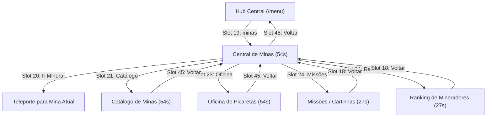

📍 [[MOC_Geral|Início]] ➔ [[MOC_Interacoes|Interações]] ➔ **gui_minas**

# ⛏️ Interface: GUI Central de Minas (`tw-minas` & `menu.yml`)

> [!abstract] Integração Nativa da Central de Mineração
> O acesso à mineração através do `/menu` principal (Slot 19) agora despacha diretamente o comando `[player] minas`, abrindo a **Central de Minas nativa de 54 slots (6 linhas)** desenvolvida no plugin proprietário `tw-minas`. 
> Todos os submenus do módulo foram integralmente reescritos em código Java para respeitar o [[gui_design_system|Design System Oficial]], possuindo molduras escuras (`BLACK_STAINED_GLASS_PANE`), lores de 3 seções e controles de navegação universal.

---

## 🗺️ Mapa de Telas do Módulo `tw-minas`

---

## 🎛️ Estrutura das Telas Java (`tw-minas`)

### 1. Central de Minas (`MinaMainMenu.java` - 54 Slots)
- **Título:** `&8➔ &#7FB4F4&lCENTRAL DE MINAS` (`§8➔ §b§lCENTRAL DE MINAS`)
- **Slot 04:** `PLAYER_HEAD` ➔ Perfil do jogador, estatísticas de blocos minerados, prestígio e saldo.
- **Slot 20:** `DIAMOND_PICKAXE` ➔ **Ir Minerar** (teleporte instantâneo para a mina do rank atual).
- **Slot 21:** `CHEST` ➔ **Catálogo de Minas** (abre `CatalogoMenu`).
- **Slot 22:** `BEACON` ➔ **Meta Comunitária** (visualização de progresso e multiplicador ativo).
- **Slot 23:** `ANVIL` ➔ **Oficina de Picaretas** (abre `OficinaMenu`).
- **Slot 24:** `BOOK` ➔ **Missões de Mineração** (abre `CartinhasMenu`).
- **Slot 31:** `GOLDEN_HELMET` ➔ **Ranking Geral** (abre `RankingMenu`).
- **Slot 45:** `ARROW` ➔ **Voltar ao Menu Central** (executa `/menu`).
- **Slot 49:** `BARRIER` ➔ **Fechar Menu**.
- **Slot 53:** `COMPASS` ➔ **Spawn Principal** (executa `/spawn`).

### 2. Catálogo de Minas (`CatalogoMenu.java` - 54 Slots)
- **Título:** `&8➔ &#7FB4F4&lCATÁLOGO DE MINAS`
- **Slot 04:** `BOOK` ➔ Informações gerais sobre a progressão de minas.
- **Slots 10 a 31:** 16 Minas (Ranks Iniciais, Ranks Avançados, VIPs e Prestígios) com indicação visual de desbloqueio, multiplicadores e taxa de blocos.
- **Slot 45:** `ARROW` ➔ **Voltar à Central de Minas** (`MinaMainMenu`).
- **Slot 48:** `NETHER_STAR` ➔ **Atalho Hub** (`/menu`).
- **Slot 49:** `BARRIER` ➔ **Fechar Menu**.

### 3. Oficina de Mineração (`OficinaMenu.java` - 54 Slots)
- **Título:** `&8➔ &#7FB4F4&lOFICINA DE MINAS`
- **Slot 04:** Picareta do Jogador com nível, XP, gemas e tokens acumulados.
- **Linhas 2 e 3:** 11 Habilidades de picareta (Eficiência, Fortuna, Explosão, Laser, Magnetismo, Escavadeira, Multiplicador, Toque Suave, Teleporte de Drops, Sorte de Minério e Auto-Venda).
- **Slot 45:** `ARROW` ➔ **Voltar à Central de Minas**.
- **Slot 49:** `BARRIER` ➔ **Fechar Menu**.

### 4. Missões & Cartinhas (`CartinhasMenu.java` - 27 Slots)
- **Título:** `&8➔ &#7FB4F4&lMISSÕES DE MINERAÇÃO`
- **Slot 04:** `BOOK` ➔ Estatísticas de missões diárias e multiplicadores.
- **Slots 11, 13 e 15:** 3 Cartinhas com missões aleatórias de quebra de blocos, barra de progresso em texto e recompensas em tokens/chaves.
- **Slot 18:** `ARROW` ➔ **Voltar à Central de Minas**.
- **Slot 22:** `BARRIER` ➔ **Fechar Menu**.

### 5. Ranking de Mineradores (`RankingMenu.java` - 27 Slots)
- **Título:** `&8➔ &#7FB4F4&lRANKING DE MINERADORES`
- **Slot 04:** `NETHER_STAR` ➔ Informações do ciclo de recompensas semanal do ranking.
- **Slots 11, 13 e 15:** Top 1 (Ouro), Top 2 (Ferro) e Top 3 (Cobre) com skins dos líderes e total de blocos minerados.
- **Slot 18:** `ARROW` ➔ **Voltar à Central de Minas**.
- **Slot 22:** `BARRIER` ➔ **Fechar Menu**.

---

## 🔄 Navegação Universal e Whitelist
- O comando `/minas` (e `/mina`) está catalogado no `plugins/CommandWhitelist/config.yml` para garantir que qualquer jogador em qualquer grupo consiga acionar as interfaces sem restrição de permissão de comando.
- O botão voltar em todos os submenus agora sempre respeita a hierarquia:
  - Submenu ➔ Central de Minas ➔ `/menu` (Hub Central).

---
⬅️ [[gui_menu_principal|Nota Anterior: GUI Menu Principal]] | 🔼 [[MOC_Interacoes|Voltar a Interações]] | ➡️ [[gui_tw_plugins|Próxima Nota: Menus TW-Plugins]]
